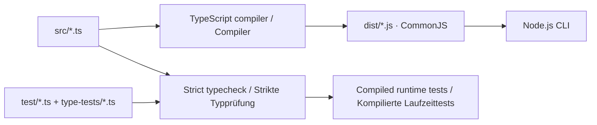

## Rezept Graph

CLI-first Anwendung, die Rezept-URLs einliest, HTML-Seiten lokal cached, Rezeptinhalt extrahiert und daraus mit einer OpenAI-kompatiblen LLM strukturierte Rezeptdaten, Zutatenlisten und Mermaid-Graphen erzeugt.

### Einrichtung / Setup

Voraussetzung / Prerequisite: **Node.js 24 oder neuer / Node.js 24 or newer**.
Das Backend und seine Tests sind in streng geprüftem TypeScript geschrieben.
The backend and its tests use strictly checked TypeScript, compiled to CommonJS.

```bash
cd backend
npm ci
npm run typecheck
npm run build
npm test
```

Deutsch: `npm start -- ...` baut vor jedem Start automatisch neu. Für den direkten
Aufruf `node backend/src/cli.js ...` vom Hauptverzeichnis muss zuerst einmal
`npm --prefix backend run build` ausgeführt werden. Die kleine JavaScript-Datei
ist nur ein Kompatibilitätsadapter; die Anwendung liegt in `backend/src/*.ts`.
`backend/dist/` enthält ausschließlich kompilierte Anwendungsmodule,
`backend/.test-dist/` die kompilierten Tests und deren Anwendungsmodule.
Beide Ausgabeordner werden vor ihrem jeweiligen Build geleert und nicht versioniert.

English: `npm start -- ...` rebuilds automatically before each invocation. Before
using the direct `node backend/src/cli.js ...` command from the project root, run
`npm --prefix backend run build`. That small JavaScript file is only a compatibility
adapter; application code lives in `backend/src/*.ts`. `backend/dist/` contains
compiled application modules only; `backend/.test-dist/` contains compiled tests
and their application modules. Each build cleans only its own output directory;
neither directory is committed. No TypeScript runtime loader is required.



Deutsch: `npm test` prüft zuerst sämtliche Typen einschließlich negativer
Vertragstests und führt danach die kompilierten Laufzeittests aus. JSON aus
Config, Cache und LLM wird weiterhin zur Laufzeit geprüft oder als `unknown`
behandelt. TypeScript ersetzt diese Prüfungen nicht. Das Frontend enthält noch
keine Anwendung und ist von dieser Migration nicht betroffen.

English: `npm test` first checks all types, including negative contract fixtures,
then runs compiled runtime tests. External configuration, cache and LLM JSON
remains runtime-validated or contained as `unknown`; TypeScript does not replace
runtime checks. The frontend has no application code yet and is unchanged.

Deutsch: Kopiere im Projekt-Hauptverzeichnis `config.example.json` nach `config.json`
und passe Modell, Anbieter und Umgebungsvariablen an. `config.json` bleibt lokal und
wird von Git ignoriert. Eine bestehende `backend/config.json` muss manuell nach oben
verschoben werden; vorhandene Root-Dateien nicht überschreiben. Relative Cache- und
Ausgabepfade beziehen sich auf den Config-Ordner und müssen beim Umzug angepasst
werden (z. B. `outputs` → `backend/outputs`).

English: From the project root, copy `config.example.json` to `config.json` and
configure the model, provider and environment variables. The local config is
ignored by Git. Move an existing `backend/config.json` manually, without overwriting
an existing root config. Rebase relative cache/output paths to preserve their
destinations (for example, `outputs` → `backend/outputs`).

```bash
cp config.example.json config.json
```

PowerShell: `Copy-Item config.example.json config.json` (nur wenn das Ziel fehlt / only if the destination is absent).

### Backend CLI

Aus dem Hauptverzeichnis / From the project root:

```bash
node backend/src/cli.js analyze --urls backend/examples/recipe-urls.txt
```

Aus dem Backend / From the backend directory:

```bash
cd backend
npm start -- analyze --urls examples/recipe-urls.txt
```

Ohne `--config` wird immer `config.json` im Projekt-Hauptverzeichnis geladen.
Explizite relative Config-Pfade beziehen sich weiterhin auf das Arbeitsverzeichnis.
Zum Verwenden der Vorlage im Backend: `--config ../config.example.json`.
`backend/go.cmd` funktioniert unabhängig vom Aufrufverzeichnis.

Without `--config`, the CLI always loads project-root `config.json`. Explicit relative
config paths remain relative to the working directory. From backend, use
`--config ../config.example.json` to select the example. `backend/go.cmd` works
independently of the caller's working directory. The example retains cache/output
locations under `backend/`; URL examples stay in `backend/examples/`.

Wichtige Optionen:

- `--config <path>`: JSON-Konfiguration fuer LLM, Cache und Ausgabe.
- `--urls <path>`: Textdatei mit Rezept-URLs. Leerzeilen und `#`-Kommentare werden ignoriert.
- `--cache-mode <cache-first|refresh|offline>`: steuert, ob HTML aus dem Cache gelesen oder neu abgerufen wird.
- `--output-dir <path>`: Zielordner fuer `.recipe.json`, `.ingredients.txt` und `.mmd`.
- `--intermediate-states <show|hide>`: Mermaid-Ausgabe mit oder ohne Zwischenzustaende.

### Chefkoch-Beispiel-URLs

Chefkoch-Zufallsrezepte werden nicht automatisch abgefragt. Zum Befuellen der Beispiel-URL-Datei gibt es ein explizites Kommando:

```bash
cd backend
npm start -- seed-chefkoch --urls examples/recipe-urls.txt --limit 5
```

Aufgenommen werden nur Rezepte von `https://www.chefkoch.de/rs/s0/zufall/Rezepte.html` mit Bewertung groesser als `4` und mehr als `10` Bewertungen. Bereits vorhandene URLs werden nicht doppelt eingetragen.

### Config

Siehe `config.example.json` im Hauptverzeichnis. Die LLM-Konfiguration ist OpenAI-kompatibel:

- `llm.baseUrl`
- `llm.baseUrlEnv` optional, falls die Base-URL aus `.env` kommen soll
- `llm.provider`: `openai` fuer OpenAI-kompatible `/v1/chat/completions`, `ollama` fuer Ollama native `/api/chat`
- `llm.model`
- `llm.apiKeyEnv`
- `llm.timeoutMs`

Lokale Anbieter wie LM Studio oder kompatible Gateways koennen verwendet werden, solange sie `/v1/chat/completions` anbieten.

Fuer Ollama Cloud direct sollte die Config `provider: "ollama"` verwenden und `BASE_URL` auf `https://ollama.com` zeigen. Die Ollama-Cloud-Dokumentation beschreibt den direkten Cloud-Zugriff ueber `https://ollama.com/api/chat` mit `Authorization: Bearer ...`.

Die CLI laedt `.env` automatisch aus dem aktuellen Arbeitsverzeichnis, dessen Parent-Verzeichnis und dem Config-Verzeichnis. Vorhandene Shell-Variablen haben Vorrang. Wenn deine Config also `"apiKeyEnv": "API_KEY"` und `"baseUrlEnv": "BASE_URL"` setzt, koennen die Werte in `.env` stehen:

```bash
API_KEY=...
BASE_URL=...
```

### Tests

```bash
cd backend
npm test
```
