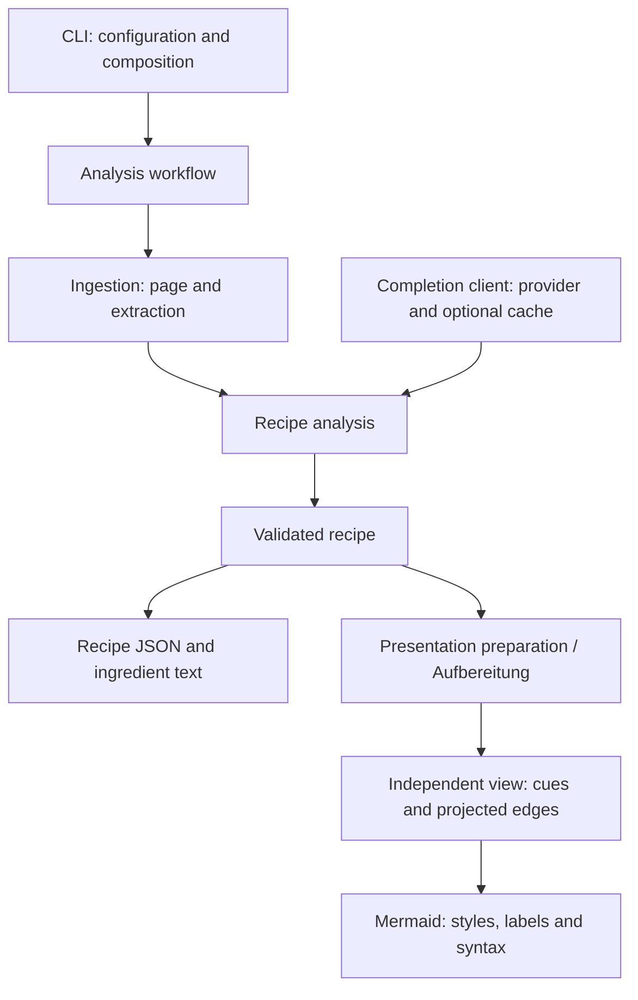

# Backend responsibilities / Backend-Verantwortlichkeiten

## English

The backend uses strict TypeScript compiled to CommonJS, with ordinary functions
and explicit imports. There is no workflow framework or runtime injection container.

| Source area (`backend/src/`) | Responsibility |
| --- | --- |
| `cli/` | Arguments, composition, terminal reporting and exit mapping |
| `config/` | Configuration, environment loading and resolved paths |
| `workflows/` | Ordered analysis and discovery/persistence orchestration |
| `ingestion/` | URL files, page retrieval/cache and source extraction |
| `discovery/` | Chefkoch acquisition, parsing and candidate filtering |
| `analysis/` | Recipe prompt bytes, response parsing and validation |
| `recipe/` | Recipe types and runtime schema validation |
| `llm/` | Provider clients and optional raw completion-response caching |
| `presentation/` | Semantic display cues and visible graph projection |
| `output/` | Ingredient formatting, filenames, JSON/text writing and Mermaid serialization |

`errors.ts`, `unknown-data.ts` and `http-types.ts` remain small shared contracts.
`source-identity.ts` preserves the existing SHA-256 source identity used by page
cache keys (24 hexadecimal characters) and output suffixes (first 8 characters).
Completion caches retain their separate stable-object identity and format.

The CLI resolves configuration and injects a `complete(messages)` capability into
analysis through the workflow. Analysis never constructs provider clients or reads
cache storage. Workflows return results and expose an optional progress callback;
only the CLI writes terminal messages. Processing stops at the first failure.
Discovery returns ordered, filtered candidates; its workflow handles URL persistence.



Recipe facts stay separate from presentation interpretation. Preparation copies
node and edge records, adds syntax-independent `hot`, `coldPassive` and `passive`
cues, and projects hidden intermediate states without changing the recipe.
Hot styling takes precedence over cold/passive styling, while passive shape is
independent. The existing non-recursive edge projection and keyword/temperature
heuristics are intentionally preserved, not corrected here. The renderer consumes
only prepared graphs and maps cues to colors/classes/shapes, escapes text and IDs,
and emits Mermaid. Recipe JSON never receives cues or view-derived edges.

Stable commands:

```bash
npm --prefix backend run build
node backend/src/cli.js --help
node backend/src/cli.js analyze --urls backend/examples/recipe-urls.txt
cd backend
npm start -- analyze --urls examples/recipe-urls.txt
npm test
```

`backend/src/cli.js` remains the JavaScript compatibility shim;
`backend/src/cli.ts` emits the thin `dist/cli.js` executable/export entry.
Internal flat module paths are not compatibility APIs. Default config is always
project-root `config.json`, independently of root/backend working directory.
Explicit config paths stay caller-relative or absolute. Configured cache/output
paths stay config-relative; `--output-dir` stays caller-relative. No local config,
cache data or output migration is performed by this restructuring.

## Deutsch

Das Backend verwendet strikt geprüftes TypeScript, kompiliert nach CommonJS.
Einfache Funktionen und explizite Imports reichen aus; es gibt weder ein
Ablauf-Framework noch einen Injection-Container.

`cli/` übernimmt Argumente, Zusammensetzung, Meldungen und Exit-Codes; `config/`
lädt Konfiguration und Umgebung und löst Pfade auf. `workflows/` koordiniert die
geordnete Analyse sowie Entdeckung und Speicherung. `ingestion/` besitzt
URL-Dateien, Seitenabruf, Seiten-Cache und Extraktion; `discovery/` beschafft,
liest und filtert Chefkoch-Kandidaten. `analysis/` besitzt Rezept-Prompts,
Antwortauswertung und Validierungsaufruf, `recipe/` die Typen und Schema-Prüfung.
`llm/` kapselt Provider und optionalen Cache unveränderter Antworttexte.
`presentation/` erzeugt semantische Ansichten, `output/` formatiert Zutaten,
bestimmt Dateinamen und schreibt JSON, Text und Mermaid.

Die CLI setzt den Completion-Client zusammen. Die Analyse erhält nur
`complete(messages)` und greift weder auf Provider-Erzeugung noch Cache-Dateien
zu. Abläufe liefern Ergebnisse und optional Fortschrittsereignisse statt
Konsolenausgaben. Der erste Fehler beendet die Verarbeitung. Die Entdeckung
liefert geordnete Kandidaten; erst ihr Ablauf speichert diese über die URL-API.

Rezeptdaten und Darstellungsinterpretation bleiben getrennt. Die Aufbereitung
kopiert Knoten und Kanten, ergänzt die syntaxfreien Merkmale `hot`, `coldPassive`
und `passive` und projiziert ausgeblendete Zwischenzustände ausschließlich in
der Ansicht. Heiß-Stil hat Vorrang, die passive Form ist davon unabhängig.
Bestehende Heuristiken und die nicht-rekursive Kantenüberbrückung bleiben
absichtlich unverändert. Der Renderer übersetzt nur vorbereitete Ansichten in
Farben, Klassen, Formen, Beschriftungen und Mermaid-Syntax. Die Rezeptdatei
enthält weder Darstellungsmerkmale noch abgeleitete Ansichtskanten.

Die oben gezeigten Startbefehle bleiben gültig. `backend/src/cli.js` ist weiterhin
der JavaScript-Adapter; `backend/src/cli.ts` erzeugt den dünnen Einstieg
`dist/cli.js`. Alte interne flache Modulpfade sind keine Kompatibilitäts-API.
Die Standard-Config bleibt `config.json` im Hauptverzeichnis, unabhängig vom
Arbeitsverzeichnis. Explizite Config-Pfade bleiben aufrufrelativ oder absolut;
Cache- und Ausgabeziele bleiben config-relativ, `--output-dir` aufrufrelativ.
Lokale Configs, Cache-Daten und Ausgaben werden durch diesen Umbau nicht migriert.
Der gemeinsame Quell-Hash behält 24 Hex-Zeichen für Seiten und die ersten acht
für Dateinamen; der Antwortcache behält sein separates Schlüsselverfahren.

## Verification / Absicherung

English: `npm test` checks types, builds, and runs all tests. Fixed fixtures in
`backend/test/fixtures/` compare exact recipe JSON, ingredient text, both Mermaid
views, filenames, prompt bytes and cache keys. Focused tests cover workflow order,
failure stops, provider/cache composition, view independence/non-mutation,
renderer-only cue mapping, import boundaries and startup/configuration paths.

Deutsch: `npm test` prüft Typen, baut und führt alle Tests aus. Feste Referenzen
in `backend/test/fixtures/` sichern Rezept-JSON, Zutaten, beide Mermaid-Ansichten,
Dateinamen, Prompt-Bytes und Cache-Schlüssel exakt ab. Weitere Tests prüfen
Ablaufreihenfolge, Fehlerabbruch, Client-/Cache-Zusammensetzung, unabhängige
unverändernde Ansichten, reines Rendering, Imports sowie Start- und Config-Pfade.
