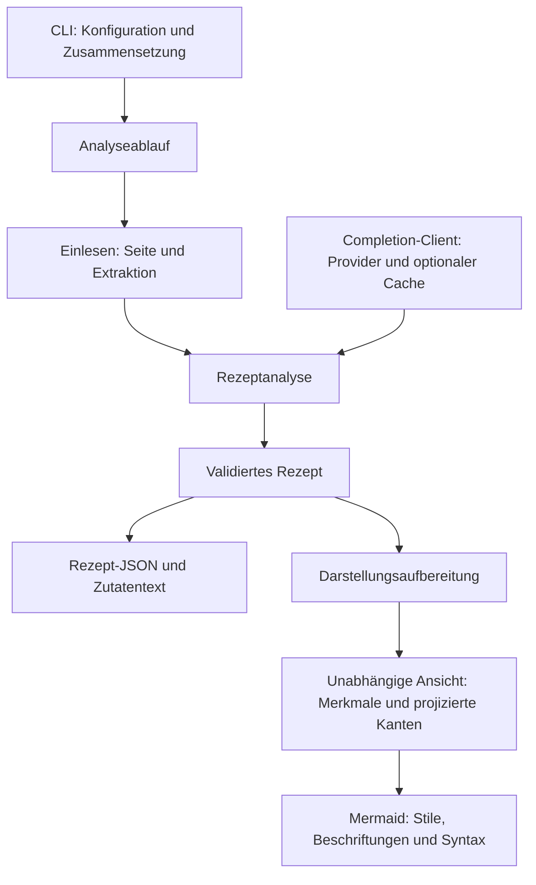

# Backend-Verantwortlichkeiten und Datenfluss

[Übersicht](../README.md) · [English](backend-architecture_en.md)

Die automatische SVG-/PNG-Erzeugung ist unter [Graph-Rendering](graph-rendering_de.md) beschrieben.

Das Backend verwendet strikt geprüftes TypeScript, kompiliert nach CommonJS.
Einfache Funktionen und explizite Imports reichen aus; es gibt weder ein
Ablauf-Framework noch einen Injection-Container.

## Modulgrenzen

| Quellbereich (`backend/src/`) | Verantwortung |
| --- | --- |
| `cli/` | Argumente, Zusammensetzung, Konsolenmeldungen und Exit-Codes |
| `config/` | Konfiguration, Umgebungsvariablen und Pfadauflösung |
| `workflows/` | Geordnete Analyse sowie Entdeckung und Speicherung |
| `ingestion/` | URL-Dateien, Seitenabruf, Seiten-Cache und Extraktion |
| `discovery/` | Beschaffung, Auswertung und Filterung von Chefkoch-Kandidaten |
| `analysis/` | Rezept-Prompts, Antwortauswertung und Validierungsaufruf |
| `recipe/` | Rezepttypen und Laufzeit-Schema-Prüfung |
| `llm/` | Provider-Clients und optionaler Cache unveränderter Antworttexte |
| `presentation/` | Semantische Darstellungsmerkmale und sichtbare Graphprojektion |
| `output/` | Zutatenformatierung, Dateinamen, JSON-/Textausgabe und Mermaid-Serialisierung |

`errors.ts`, `unknown-data.ts` und `http-types.ts` bleiben kleine gemeinsame
Verträge. `source-identity.ts` bewahrt die bestehende SHA-256-Quellidentität:
24 Hex-Zeichen für Seiten-Cache-Schlüssel, die ersten acht für Ausgabe-Dateinamen.
Der Antwortcache behält sein separates Schlüsselverfahren auf Basis stabiler
Objekte und sein eigenes Format.

## Datenfluss

Die CLI löst die Konfiguration auf und setzt den Completion-Client zusammen.
Die Analyse erhält über den Ablauf nur `complete(messages)` und greift weder auf
Provider-Erzeugung noch Cache-Dateien zu. Abläufe liefern Ergebnisse und optional
Fortschrittsereignisse; nur die CLI schreibt Konsolenmeldungen. Der erste Fehler
beendet die Verarbeitung. Die Entdeckung liefert geordnete, gefilterte Kandidaten;
erst ihr Ablauf speichert diese über die URL-API.



## Rezeptdaten und Darstellung

Rezeptdaten und Darstellungsinterpretation bleiben getrennt. Die Aufbereitung
kopiert Knoten und Kanten, ergänzt die syntaxfreien Merkmale `hot`, `coldPassive`
und `passive` und projiziert ausgeblendete Zwischenzustände ausschließlich in
der Ansicht. Heiß-Stil hat Vorrang vor Kalt-/Passiv-Stil; die passive Form ist
davon unabhängig. Bestehende Schlüsselwort-/Temperaturheuristiken und die
nicht-rekursive Kantenüberbrückung bleiben absichtlich unverändert. Der Renderer
übersetzt nur vorbereitete Ansichten in Farben, Klassen, Formen, Beschriftungen
und Mermaid-Syntax und maskiert Texte und IDs. Die Rezeptdatei enthält weder
Darstellungsmerkmale noch abgeleitete Ansichtskanten.

## Stabile Einstiegspunkte und Pfade

```bash
npm --prefix backend run build
node backend/src/cli.js --help
node backend/src/cli.js analyze --urls backend/examples/recipe-urls.txt
cd backend
npm start -- analyze --urls examples/recipe-urls.txt
npm test
```

`backend/src/cli.js` ist weiterhin der JavaScript-Kompatibilitätsadapter;
`backend/src/cli.ts` erzeugt den dünnen ausführbaren/exportierten Einstieg
`dist/cli.js`. Alte interne flache Modulpfade sind keine Kompatibilitäts-API.

Die Standard-Konfiguration bleibt `config.json` im Hauptverzeichnis, unabhängig
vom Arbeitsverzeichnis. Explizite Konfigurationspfade bleiben aufrufrelativ oder
absolut; Cache- und Ausgabeziele bleiben konfigurationsrelativ, `--output-dir`
aufrufrelativ. Die Struktur führt keine automatische Migration lokaler
Konfigurationen, Cache-Daten oder Ausgaben durch. Details stehen in der
[Konfigurationsanleitung](configuration_de.md).

## Absicherung

Testbefehl und Testabdeckung sind unter [Einrichtung und Tests](setup_de.md#tests)
beschrieben.
