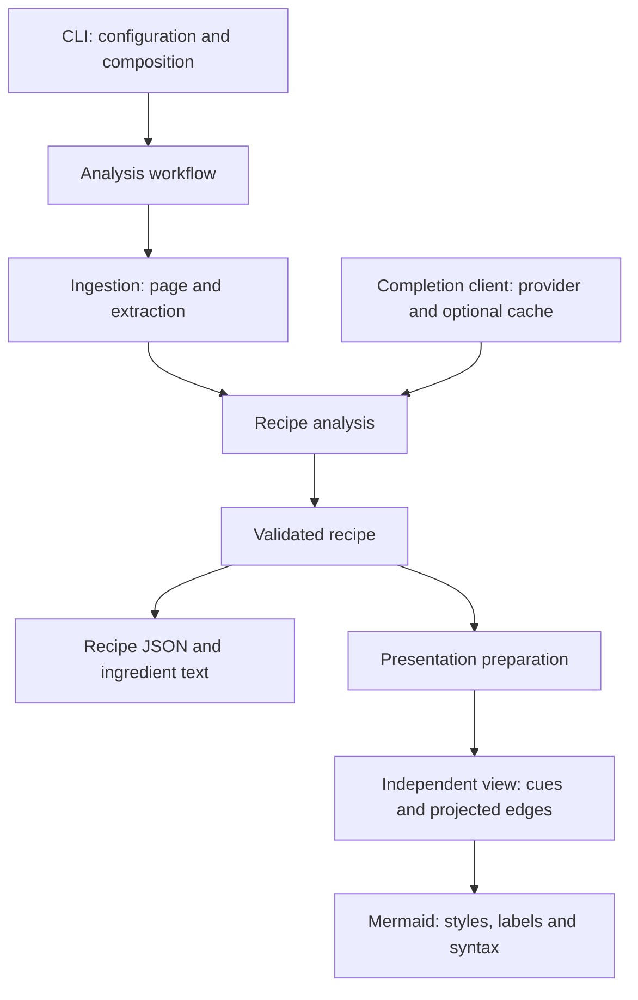

# Backend responsibilities and data flow

[Overview](../README.md) · [Deutsch](backend-architecture_de.md)

Automatic SVG/PNG generation is described in [graph rendering](graph-rendering_en.md).

The backend uses strict TypeScript compiled to CommonJS, with ordinary functions
and explicit imports. There is no workflow framework or runtime injection container.

| Source area (`backend/src/`) | Responsibility |
| --- | --- |
| `cli/` | Arguments, composition, terminal reporting and exit mapping |
| `config/` | Configuration, environment loading and resolved paths |
| `workflows/` | Ordered analysis and discovery/persistence orchestration |
| `ingestion/` | URL files, page retrieval/cache and source extraction |
| `discovery/` | Chefkoch acquisition, parsing and candidate filtering |
| `analysis/` | Recipe prompt bytes, response parsing and validation |
| `recipe/` | Recipe types and runtime schema validation |
| `llm/` | Provider clients and optional raw completion-response caching |
| `presentation/` | Semantic display cues and visible graph projection |
| `output/` | Ingredient formatting, filenames, JSON/text writing and Mermaid serialization |

`errors.ts`, `unknown-data.ts` and `http-types.ts` remain small shared contracts.
`source-identity.ts` preserves the existing SHA-256 source identity used by page
cache keys (24 hexadecimal characters) and output suffixes (first 8 characters).
Completion caches retain their separate stable-object identity and format.

The CLI resolves configuration and injects a `complete(messages)` capability into
analysis through the workflow. Analysis never constructs provider clients or reads
cache storage. Workflows return results and expose an optional progress callback;
only the CLI writes terminal messages. Processing stops at the first failure.
Discovery returns ordered, filtered candidates; its workflow handles URL persistence.



Recipe facts stay separate from presentation interpretation. Preparation copies
node and edge records, adds syntax-independent `hot`, `coldPassive` and `passive`
cues, and projects hidden intermediate states without changing the recipe.
Hot styling takes precedence over cold/passive styling, while passive shape is
independent. The existing non-recursive edge projection and keyword/temperature
heuristics are intentionally preserved, not corrected here. The renderer consumes
only prepared graphs and maps cues to colors/classes/shapes, escapes text and IDs,
and emits Mermaid. Recipe JSON never receives cues or view-derived edges.

Stable commands:

```bash
npm --prefix backend run build
node backend/src/cli.js --help
node backend/src/cli.js analyze --urls backend/examples/recipe-urls.txt
cd backend
npm start -- analyze --urls examples/recipe-urls.txt
npm test
```

`backend/src/cli.js` remains the JavaScript compatibility shim;
`backend/src/cli.ts` emits the thin `dist/cli.js` executable/export entry.
Internal flat module paths are not compatibility APIs. Default config is always
project-root `config.json`, independently of root/backend working directory.
Explicit config paths stay caller-relative or absolute. Configured cache/output
paths stay config-relative; `--output-dir` stays caller-relative. No local config,
cache data or output migration is performed by this restructuring.

## Verification

See [setup and tests](setup_en.md#tests) for the test command and coverage.
