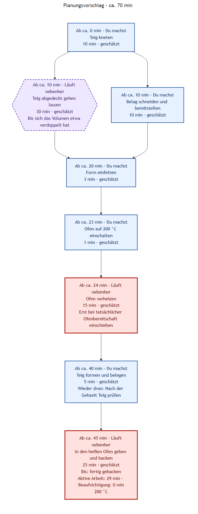
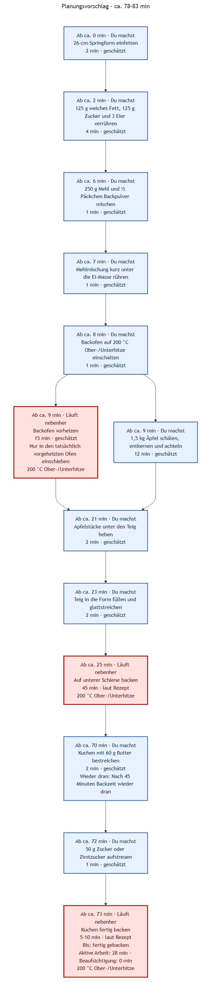

# Visuelle Kochansicht für eine Person

Der normale `analyze`-Befehl erzeugt zusätzlich zum bisherigen Rezeptgraphen eine
Kochansicht. Es sind keine neuen Optionen erforderlich:

```powershell
# Im Verzeichnis backend
npm start -- analyze --config ../config.json --urls examples/recipe-urls.txt
```

## Was sehe ich?

- **Du machst:** konkrete Handgriffe in vorgeschlagener Reihenfolge. Aktive und
  ständig zu beaufsichtigende Tätigkeiten überschneiden sich nicht.
- **Läuft nebenher:** unbeaufsichtigte Vorgänge wie Gehenlassen, Vorheizen und Backen.
- **Ab ca. … min:** ungefähre Zeit seit Rezeptbeginn, keine Uhrzeit. Die Position
  eines Kastens und die Länge einer Verbindung sind **nicht maßstabsgetreu**.
- **Wieder dran:** ein wichtiger Eingriff, zum Beispiel Bestreichen nach 45 Minuten
  Backzeit. Der ereignisbezogene Hinweis gilt auch, wenn die Vorbereitung länger dauert.
- **Gesamtzeit:** bis zum ausdrücklich genannten Endpunkt, etwa „fertig gebacken“.
  Abkühlzeit ist nur enthalten, wenn sie eingeplant ist; Hinweise dazu stehen im Bild.
- **Aktive Arbeit / Beaufsichtigung:** getrennte Zeitbedarfe. Beaufsichtigung ist
  keine freie Zeit.

Die Ansicht ist ein einfacher Planungsvorschlag für **eine Person**, keine optimale
Küchenplanung. Der vorhandene Zutaten-/Abhängigkeitsgraph bleibt separat erhalten.

## Zeiten und Unsicherheit

**Laut Rezept** bezeichnet aus dem Rezept übernommene Zeiten. **Geschätzt** bezeichnet
zusätzlich angenommene Dauern, beispielsweise zum Schneiden oder Vorheizen. Die
Begründung steht in der Timeline-JSON. Zeitbereiche und Startzeiten sind Näherungen;
persönliches Tempo und Geräte unterscheiden sich. Eine nicht verantwortbar schätzbare
Dauer bleibt **unbekannt**; betroffene spätere Zeiten und die Gesamtdauer werden dann
nicht als vollständige Zahlen ausgegeben.

Zielzustände wie „Volumen verdoppelt“ bleiben wichtig. Der Ofen muss tatsächlich heiß
sein, bevor etwas hineinkommt – die geschätzte Aufheizzeit ersetzt keine Kontrolle.
Quell-Garzeiten werden nicht zur Verkürzung des Plans geändert. Prüfe Rezept und
LLM-Schätzungen vor dem Kochen; die Validierung prüft Struktur und Abhängigkeiten,
nicht die fachliche Richtigkeit jeder Schätzung oder Quelleninterpretation.

## Zusätzliche Dateien

Alle neun Ausgaben verwenden denselben Rezeptstamm im konfigurierten Ausgabeordner:

| Datei | Inhalt |
| --- | --- |
| `.recipe.json`, `.ingredients.txt`, `.mmd`, `.svg`, `.png` | Bisherige Rezept- und Graph-Ausgaben |
| `.timeline.json` | Phasen, Herkunft/Begründung der Zeiten, Abhängigkeiten, Annahmen und berechneter Ablauf |
| `.timeline.mmd` | Mermaid-Quelle der Kochansicht |
| `.timeline.svg`, `.timeline.png` | Kochansicht als Bild |

Die Darstellung verwendet Farben, Formen und Linien des bestehenden Rezeptgraphen.
Schritte stehen chronologisch untereinander, gleichzeitig beginnende Vorgänge
nebeneinander. „Du machst“ und „Läuft nebenher“ stehen direkt am Schritt; es gibt
keine großen farbigen Spuren. Die Verbindungen zeigen die chronologische Lesereihenfolge,
nicht zusätzliche fachliche Abhängigkeiten. Es gibt keine maßstabsgetreue Gantt-Achse.
Das Ausblenden von Zwischenzuständen im Rezeptgraphen entfernt keine notwendigen
Schritte oder Voraussetzungen aus der Kochplanung.

## LLM, Cache und Fehler

Ein zusätzlicher LLM-Aufruf ergänzt Zeitabschätzungen und Aufmerksamkeitsbedarf. Er
verwendet denselben konfigurierten Anbieter und Antwortcache wie die Rezeptanalyse,
hat aber wegen eigener Nachrichten einen **separaten Cache-Eintrag**. Vorhandene
Analyse-Caches bleiben gültig. Bei identischen Eingaben wird die Ergänzung erneut
aus dem Cache gelesen; der Zeitplan selbst wird deterministisch berechnet.
Der erste Aufruf kann zusätzliche Zeit und API-Kosten verursachen. Ein reiner
HTML-Offline-Cache garantiert nicht, dass auch die neue LLM-Antwort schon gecacht ist.

Die bisherigen fünf Dateien werden zuerst erzeugt. Scheitert anschließend die
Planung oder das Timeline-Rendering, meldet die CLI einen Fehler und keinen vollständigen
Erfolg. Aktuelle Originalausgaben und verfügbare aktuelle Timeline-Textdaten bleiben
erhalten; alte oder teilweise erzeugte Timeline-Bilder werden entfernt. JSON-/Mermaid-
Dateien aus einem früheren Lauf können bei einem frühen Fehler noch vorhanden sein:
Sie dürfen ohne erfolgreichen Lauf nicht als aktuelle Planung verstanden werden.
Andere Rezepte werden nicht bereinigt. Die Render-Voraussetzungen stehen unter
[Bildausgabe](graph-rendering_de.md).

## Beispiele

Die folgenden Bilder sind deterministisch erzeugte **Beispielplanungen**, keine
live vom LLM erzeugten Ergebnisse. Beim Hefeteig sind alle Dauern illustrative
Schätzungen; beim Apfelkuchen stammen 45 Minuten und weitere 5–10 Minuten aus der
vorhandenen Rezeptanalyse, Vorbereitung und Vorheizen sind Beispielschätzungen.

### Hefeteig mit paralleler Vorbereitung



### Apfelkuchen mit Eingriff nach 45 Minuten


