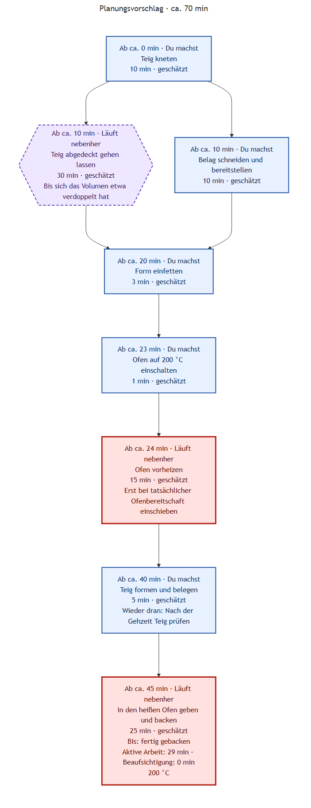
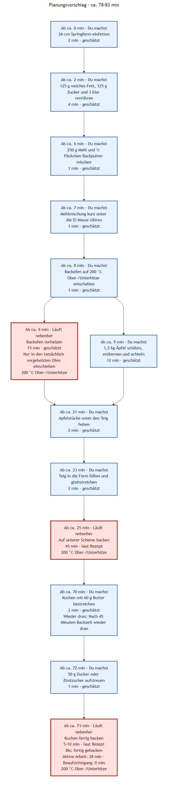

# Visual cooking guide for one person

The normal `analyze` command now produces a cooking view alongside the original
recipe graph. No new options are required:

```powershell
# From backend
npm start -- analyze --config ../config.json --urls examples/recipe-urls.txt
```

## Reading the view

- **You do:** concise actions in suggested order. Hands-on and continuously attended
  tasks never overlap.
- **Runs alongside:** unattended processes such as rising, preheating, and baking.
- **From approx. … min:** approximate elapsed minutes since starting, not clock time.
  Box positions and connector lengths are **not to scale**.
- **Return:** an important intervention, such as brushing after 45 minutes of baking.
  The event-relative cue still applies if preparation takes longer.
- **Total:** until the named endpoint, such as “finished baking”. Cooling is included
  only when planned; the image states relevant exclusions.
- **Hands-on / Attended:** separate time requirements. Attended time is not free time.

This is a simple suggested plan for **one cook**, not an optimal kitchen schedule.
The ingredient/dependency graph remains available as a separate view.

## Durations and uncertainty

**Recipe** marks durations taken from the recipe. **Estimated** marks additional
assumptions, such as chopping or preheating time. The rationale is stored in the
timeline JSON. Ranges and offsets are approximate; individual pace and appliances
vary. Durations that cannot responsibly be estimated stay **unknown**; affected
downstream offsets and the overall total are not presented as complete numbers.

Readiness conditions such as “until doubled” still matter. The oven must actually
be ready before inserting food; an estimated warm-up time does not replace checking.
Source cooking times are not shortened to optimize the plan. Check the recipe and
LLM estimates before cooking: validation checks structure and dependencies, not the
culinary correctness of every estimate or source interpretation.

## Additional files

All nine outputs share the recipe stem and configured output directory:

| File | Content |
| --- | --- |
| `.recipe.json`, `.ingredients.txt`, `.mmd`, `.svg`, `.png` | Existing recipe and graph outputs |
| `.timeline.json` | Phases, duration evidence/rationale, dependencies, assumptions, and computed schedule |
| `.timeline.mmd` | Mermaid source for the cooking view |
| `.timeline.svg`, `.timeline.png` | Cooking-view images |

The view reuses the existing graph's colors, shapes, and connectors. Steps appear
in chronological rows, with simultaneously starting phases side by side. Attention
labels appear inside nodes rather than large colored swimlanes. Connectors indicate
chronological reading order, not additional prerequisites. There is no scaled Gantt axis. Hiding intermediate
states in the recipe graph does not remove required steps or prerequisites from planning.

## LLM, cache, and errors

An additional LLM request supplies timing estimates and attention information. It
uses the same configured completion provider and response cache as analysis, but
different messages give it a **separate cache entry**. Existing analysis cache entries
remain valid. Identical inputs reuse cached enrichment; scheduling itself is deterministic.
The first request can add latency and API cost. An offline HTML cache does not imply
the new LLM response has already been cached.

The original five files are generated first. Subsequent planning or timeline rendering
failure produces an error instead of full recipe success. Current original outputs and
available current timeline text data remain; stale or partial timeline images are
removed. Earlier JSON/Mermaid sidecars can remain after early failure and must not be
treated as current planning without a successful run. Other recipes remain untouched.
See [image outputs](graph-rendering_en.md) for rendering prerequisites.

## Examples

These are deterministic **sample plans**, not live LLM-generated results. The bread
sample uses illustrative estimates throughout. For the apple cake, 45 minutes and
another 5–10 minutes come from the existing analyzed recipe; preparation and warm-up
durations are sample estimates. Labels follow the German sample recipe language.

### Dough with parallel preparation



### Apple cake with an intervention after 45 minutes


