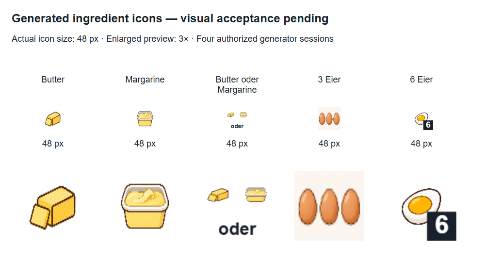
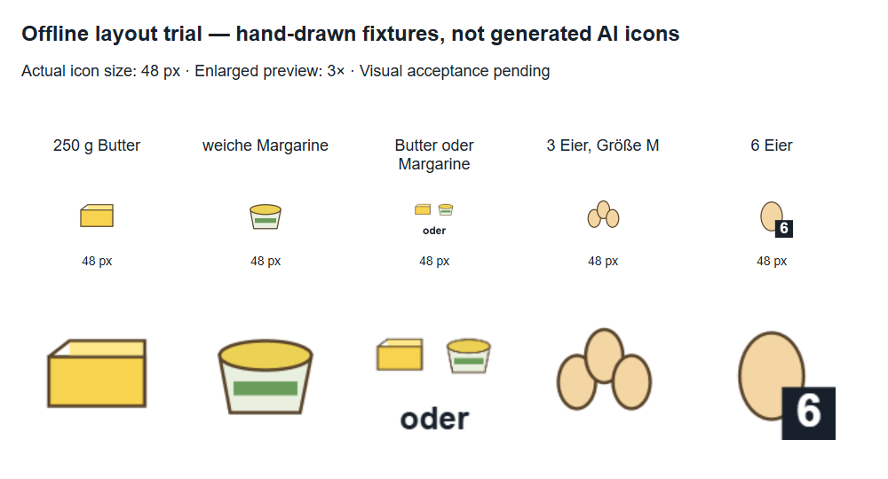
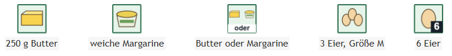

# Zutaten-Icons: visueller Versuch

[English](ingredient_icon_trial_en.md) · [Betrieb und Konfiguration](recipe_icons_de.md)

## Stand

### Nutzerfeedback und Abschluss der Zustandstrennung

Der Nutzer akzeptiert das aktuelle Innen-links-Layout vorläufig („sieht für mich erstmal ok aus“). Das gekochte offene Grundmotiv wurde als ungeeignet bestätigt. Die daraus folgende Zustandsänderung ist nun implementiert: getrennte rohe/gekochte/gebratene Identitäten, passende Gruppen und Fallbacks sowie explizite Form im Prompt. 159 Tests einschließlich Typprüfung/Build erfolgreich. Alte Originalpakete bleiben unverändert; keine neue Bildsitzung. Die gespeicherte Apfelkuchenvorschau zeigt weiterhin die ausdrücklich gesichtete alte Dreiergruppe aus dem vorherigen lokalen Versuch; ein neuer regulärer zustandsbewusster Lauf verwendet nur neue passende Zustandspakete und zeigt bei deren Fehlen Text. Keine automatische Migration oder vermeintliche visuelle Freigabe durch Metadaten.

### Echtes Rezept lokal aktualisiert

Die gespeicherte Apfelkuchenanalyse wurde ohne Provideraufruf neu gerendert. Die reguläre PNG/SVG/Mermaid unter `backend/outputs/supersaftiger-apfelkuchen-rezept-von-oma-7c3b189b.*` enthält jetzt drei Icon-Knoten: Butter/Margarine-Alternative (`i2`), drei ganze Eier (`i4`) und Butter zum Bestreichen (`i8`). Weitere Motive fehlen lokal und bleiben Text. Das ungeeignete gekochte Ei wurde nicht verwendet. Explizit gesichtete Vorschau-Beschreibungen ersetzten für diesen Lauf die noch nicht live konfigurierte semantische Interpretation; dies ist **kein vollständiger Live-Analyselauf**. Prüfsummen von Rezept-JSON, Zutatenliste und allen vier Timeline-Dateien blieben unverändert. Die lokale Config bleibt unverändert.

Nutzerfeedback zum gekochten Ei ist bestätigt. Zustandsspezifische Identitäten für roh/gekocht/gebraten und klare Roh-Ganz-mit-Schale-Prompts sind jetzt im Change spezifiziert, aber noch nicht allgemein implementiert. Keine neuen Bilder erzeugt.

### Freigegebener Live-Versuch

Nach ausdrücklicher Nutzerfreigabe wurden genau vier neue Generatorsitzungen ausgeführt. Alle vier Motive wurden technisch geprüft und mit Metadaten in der konfigurierten Originalbibliothek gespeichert. Keine Wiederholung, keine zusätzliche Generierung für Alternative oder sechs Eier. Der Kontaktbogen und Graph wurden danach ausschließlich lokal erzeugt.



[Graph mit KI-Motiven](images/ingredient-icon-trial/live/graph.png) · [SVG](images/ingredient-icon-trial/live/graph.svg)

Erste Sichtprüfung: Das Ei-Grundmotiv zeigt ein aufgeschnittenes gekochtes Ei statt eines ganzen rohen Eis. Dadurch passt das Sechserbadge semantisch nicht gut zur rohen Rezeptzutat. Die Dreiergruppe zeigt drei ganze Eier, hat aber einen sichtbaren hellen Hintergrund. Die Alternative verkleinert die Einzelmotive stark. Diese Punkte sind **keine Nutzerabnahme**; vor etwaiger Neugenerierung erst Feedback einholen. Keine weiteren Sitzungen freigegeben. Das semantische kleine LLM wurde bei diesem Bildversuch nicht aufgerufen.

Offline-Prototyp mit **lokal gezeichneten Testbildern, nicht mit KI-generierten Motiven**. Er prüft Layout, Cache und echte SVG-/PNG-Ausgabe. Nutzerabnahme und Qualität einer echten KI-Generierung sind noch offen. Das Anzeigen oder Zusenden der Vorschauen gilt nicht automatisch als Freigabe.





[Portable SVG-Ansicht](images/ingredient-icon-trial/graph.svg)

## Was zu beurteilen ist

| Fall | Umsetzung | Abnahme |
|---|---|---|
| Butter | Grundmotiv | offen: Zutat erkennbar? |
| Margarine | Grundmotiv | offen: von Butter unterscheidbar? |
| Butter oder Margarine | Einzelmotive plus lokales „oder“ | offen: Alternative statt Mischung erkennbar? |
| Drei Eier | Gruppenbild | offen: drei erkennbar, Motiv lesbar? |
| Sechs Eier | Ei plus lokale Zahl | offen: Zutat und Zahl erkennbar? |

Die Alternative verkleinert beide Einzelmotive deutlich. Ob das genügt, entscheidet Nutzerfeedback, nicht der erfolgreiche Renderer. Gruppenbilder müssen tatsächlich die richtige Anzahl zeigen; technische PNG-Prüfung kann das nicht feststellen.

## Optionaler nächster Live-Versuch

Vor dem freigegebenen Lauf fehlten folgende vier Originalmotive; sie sind jetzt vorhanden:

1. `ingredients/butter`
2. `ingredients/margarine`
3. `ingredients/egg`
4. `ingredients/egg-count-3`

Vor dem Start ausdrücklich **höchstens vier neue Generatorsitzungen für genau diese Motive** freigeben lassen. Beim tatsächlichen Start erneut auf vorhandene gültige Pakete prüfen und sie wiederverwenden. Keine Sitzung für „sechs Eier“ oder das Alternativbild, keine vorsorglichen Zweier-/Vierer-/Fünfergruppen, keine automatischen Wiederholungen. Eine Codex-Sitzung kann intern mehrere Bildanfragen auslösen; dies ist kein fester Geldbetrag.

Der freigegebene Lauf hat die vier Bildsitzungen verbraucht. Ein kleines semantisches Modell ist noch nicht live ausgewählt oder bewertet; die Tests verwenden eingesetzte Completion-Antworten.

## Vorschauen offline reproduzieren

Im Verzeichnis `backend` (PowerShell):

```powershell
$env:INGREDIENT_ICON_PREVIEW_DIR = (Join-Path (Resolve-Path ..) 'docs/images/ingredient-icon-trial')
npm test
Remove-Item Env:INGREDIENT_ICON_PREVIEW_DIR
```

Ohne die Variable erzeugen Tests nur temporäre Dateien. Der Test `ingredient-icon-acceptance.test.ts` prüft auch Cachewiederverwendung ohne Chromium-Neustart, unveränderte Rezept-/Zutatenbytes und portable SVG-/PNG-Anzeige nach Entfernen der Bildbibliothek.
