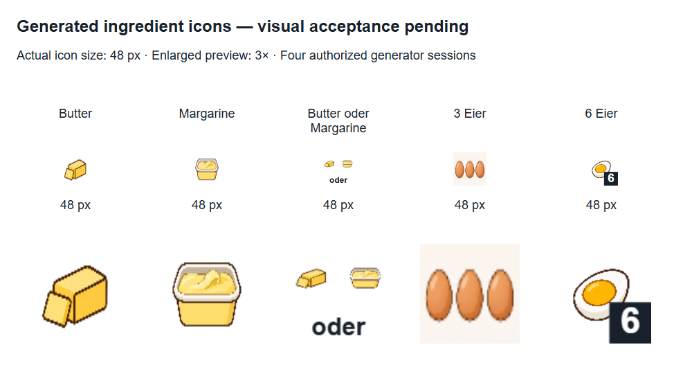
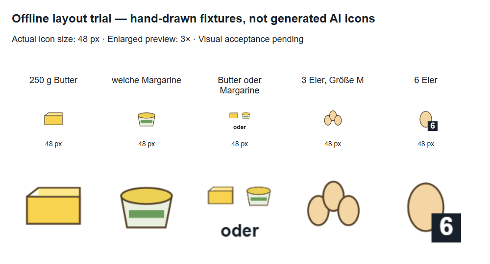
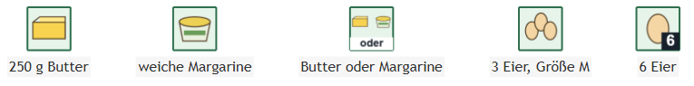

# Ingredient icons: visual trial

[Deutsch](ingredient_icon_trial_de.md) · [Operation and configuration](recipe_icons_en.md)

## Status

### User feedback and completed state separation

The user provisionally accepts the inside-left layout (“looks OK for now”). The cut boiled base was confirmed inappropriate. The resulting state change is now implemented: separate raw/boiled/fried identities, matching groups and fallback, and explicit depicted forms in prompts. All 159 tests including typecheck/build pass. Legacy original bundles remain unchanged; no new image session ran. The stored apple-cake preview still depicts the explicitly inspected legacy three-egg group from the earlier local trial; new regular state-aware runs only use matching new state bundles and retain text on misses. No automatic migration or implied visual approval through metadata.

### Stored real recipe rerendered locally

The saved apple-cake analysis was rerendered without provider calls. Regular PNG/SVG/Mermaid files under `backend/outputs/supersaftiger-apfelkuchen-rezept-von-oma-7c3b189b.*` now contain three icon nodes: butter/margarine alternative (`i2`), three whole eggs (`i4`) and butter for brushing (`i8`). Other locally missing motifs retain text. The inappropriate boiled egg was not used. Explicitly reviewed preview descriptors substituted for the not-yet-live-configured semantic interpreter; this is **not a full live analysis run**. Checksums for recipe JSON, ingredient text and all four timeline files remained unchanged. Local configuration is unchanged.

User feedback confirms the boiled-egg mismatch. State-specific raw/boiled/fried identities and explicit raw whole-shell prompts are now specified in the change but not generally implemented yet. No new images were generated.

### Authorized live trial

Following explicit user approval, exactly four new generator sessions ran. All four motifs passed technical validation and were saved with metadata in the configured original library. No retries or additional generation for the alternative or six eggs occurred. Contact-sheet and graph rendering then ran locally only.



[Generated-motif graph](images/ingredient-icon-trial/live/graph.png) · [SVG](images/ingredient-icon-trial/live/graph.svg)

Initial inspection: the egg base depicts a cut boiled egg rather than a whole raw egg, making its six-count badge a poor semantic fit for the raw ingredient. The three-egg group shows three whole eggs but has a visible light background. The alternative significantly shrinks its components. These observations are **not user acceptance**; obtain feedback before considering regeneration. No further sessions are authorized. The small semantic LLM was not called during this image trial.

Offline prototype using **locally drawn fixtures, not AI-generated motifs**. It exercises layout, caching and real SVG/PNG output. User visual acceptance and actual image-provider quality remain pending. Viewing or sharing the previews does not automatically constitute approval.





[Portable SVG view](images/ingredient-icon-trial/graph.svg)

## Review criteria

| Case | Presentation | Acceptance |
|---|---|---|
| Butter | Base motif | Pending: recognizable ingredient? |
| Margarine | Base motif | Pending: distinguishable from butter? |
| Butter or margarine | Individual motifs plus local “oder” | Pending: alternative rather than mixture? |
| Three eggs | Group picture | Pending: three countable, recognizable eggs? |
| Six eggs | Egg plus local number | Pending: ingredient and badge readable? |

The alternative substantially shrinks both components. User feedback, not successful rendering, decides whether this works. Group images require inspection of their actual object count; PNG validation cannot establish it.

## Optional next live trial

The following four original motifs were missing before the authorized run and are now present:

1. `ingredients/butter`
2. `ingredients/margarine`
3. `ingredients/egg`
4. `ingredients/egg-count-3`

Before starting, obtain explicit authorization for **at most four new generator sessions for exactly these motifs**. Recheck and reuse valid bundles at execution time. No session for six eggs or the alternative composition, no speculative two/four/five groups and no automatic retries. A Codex session may internally issue multiple image requests; this is not a fixed monetary budget.

The authorized run used its four image sessions. A small semantic model has not yet been selected or evaluated live; tests inject fixture completion responses.

## Reproduce offline previews

From `backend` in PowerShell:

```powershell
$env:INGREDIENT_ICON_PREVIEW_DIR = (Join-Path (Resolve-Path ..) 'docs/images/ingredient-icon-trial')
npm test
Remove-Item Env:INGREDIENT_ICON_PREVIEW_DIR
```

Without this variable, tests only create temporary files. `ingredient-icon-acceptance.test.ts` also checks persistent cache reuse without restarting Chromium, unchanged recipe/ingredient bytes, and portable SVG/PNG display after deleting the image library.
