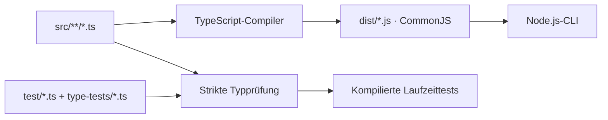

# Einrichtung und Tests

[Übersicht](../README.md) · [English](setup_en.md)

## Voraussetzungen

- Node.js **24 oder neuer**.
- Ein LLM-Anbieter; siehe [Konfiguration](configuration_de.md).

Das Backend und seine Tests verwenden strikt geprüftes TypeScript, kompiliert nach
CommonJS. Das Frontend enthält noch keine Anwendung.

## Installation

Im Projekt-Hauptverzeichnis:

```bash
cd backend
npm ci
npm run typecheck
npm run build
npm test
```

Lege anschließend im Projekt-Hauptverzeichnis eine lokale `config.json` anhand
von `config.example.json` an. **Eine vorhandene Datei nicht überschreiben.**

```bash
cp -n config.example.json config.json
```

Alternativ in PowerShell:

```powershell
if (-not (Test-Path config.json)) {
    Copy-Item config.example.json config.json
}
```

Passe Modell, Anbieter und Umgebungsvariablen gemäß der
[Konfigurationsanleitung](configuration_de.md) an. Danach kannst du
[Rezepte analysieren](cli_de.md).

## Build und Start

`npm start -- ...` im Backend baut vor jedem Start automatisch neu. Für den direkten
Aufruf `node backend/src/cli.js ...` vom Hauptverzeichnis muss zuerst
`npm --prefix backend run build` ausgeführt werden.

`backend/src/cli.js` ist nur ein JavaScript-Kompatibilitätsadapter; die Anwendung
liegt in `backend/src/**/*.ts`. Ein TypeScript-Runtime-Loader ist nicht erforderlich.

- `backend/dist/`: ausschließlich kompilierte Anwendungsmodule.
- `backend/.test-dist/`: kompilierte Tests und deren Anwendungsmodule.

Beide Ausgabeordner werden vor ihrem jeweiligen Build geleert und nicht versioniert.



## Tests

### Voraussetzungen für Bild-Rendering

Mermaid CLI ist eine Laufzeitabhängigkeit und wird auch mit `--omit=dev` installiert.
Die Puppeteer-Peer-Abhängigkeit installiert normalerweise einen passenden Chrome-
Browser. Bei übersprungenem Browser-Download führe im Backend explizit
`node node_modules/puppeteer/install.mjs` aus. Linux benötigt zusätzlich Chromes
Systembibliotheken. Die Rezeptanalyse installiert keine Pakete oder Browser.
`npm test` enthält einen echten Renderer-Test, der diesen Browser benötigt; andere
Ausgabetests verwenden einen Fake-Renderer. Plattformschriften können leichte
Abweichungen erzeugen; beide Formate verwenden dieselbe Quelle und Einstellungen.

```bash
cd backend
npm test
```

`npm test` prüft zuerst sämtliche Typen einschließlich negativer Vertragstests,
baut die Anwendung und führt danach die kompilierten Laufzeittests aus.
JSON aus Konfiguration, Cache und LLM wird weiterhin zur Laufzeit geprüft oder als
`unknown` behandelt. TypeScript ersetzt diese Prüfungen nicht.

Feste Referenzen in `backend/test/fixtures/` sichern Rezept-JSON, Zutaten, beide
Mermaid-Ansichten, Dateinamen, Prompt-Bytes und Cache-Schlüssel exakt ab. Weitere
Tests prüfen Ablaufreihenfolge, Fehlerabbruch, Client-/Cache-Zusammensetzung,
unabhängige und unverändernde Ansichten, reines Rendering, Importgrenzen sowie
Start- und Konfigurationspfade.
