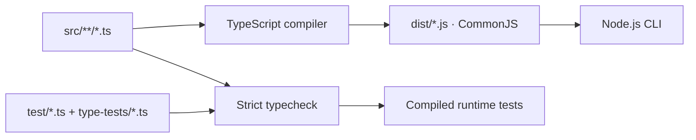

# Setup and tests

[Overview](../README.md) · [Deutsch](setup_de.md)

## Requirements

- Node.js **24 or newer**.
- An LLM provider; see [configuration](configuration_en.md).

The backend and its tests use strictly checked TypeScript compiled to CommonJS.
The frontend does not contain an application yet.

## Installation

From the project root:

```bash
cd backend
npm ci
npm run typecheck
npm run build
npm test
```

Next, create a local `config.json` in the project root using `config.example.json`.
**Do not overwrite an existing file.**

```bash
cp -n config.example.json config.json
```

Alternatively, in PowerShell:

```powershell
if (-not (Test-Path config.json)) {
    Copy-Item config.example.json config.json
}
```

Adjust the model, OpenAI-compatible API root, and environment variables as described in the
[configuration guide](configuration_en.md). Then you can
[analyze recipes](cli_en.md).

## Build and startup

`npm start -- ...` from the backend rebuilds automatically before each invocation.
Before using `node backend/src/cli.js ...` directly from the project root, run
`npm --prefix backend run build`.

`backend/src/cli.js` is only a JavaScript compatibility adapter; application code
lives in `backend/src/**/*.ts`. No TypeScript runtime loader is required.

- `backend/dist/`: compiled application modules only.
- `backend/.test-dist/`: compiled tests and their application modules.

Each build cleans only its own output directory; neither directory is committed.



## Tests

```bash
cd backend
npm test
```

`npm test` first checks all types, including negative contract fixtures, builds the
application, and then runs compiled runtime tests. External configuration, cache,
and LLM JSON remains runtime-validated or contained as `unknown`; TypeScript does
not replace runtime checks.

Fixed fixtures in `backend/test/fixtures/` compare exact recipe JSON, ingredient
text, both Mermaid views, filenames, prompt bytes, and cache keys. Focused tests
cover workflow order, failure stops, provider/cache composition, view independence
and non-mutation, renderer-only cue mapping, import boundaries, and startup and
configuration paths.
