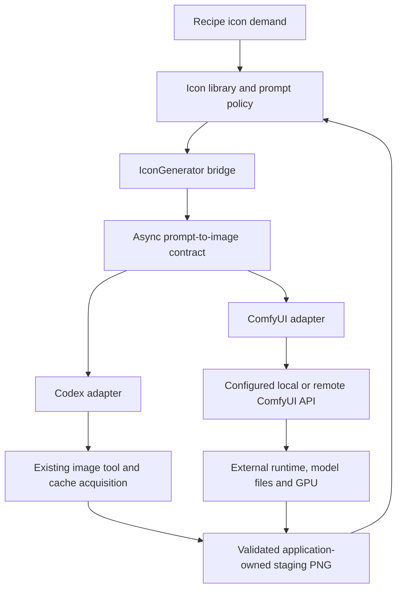

## Context

The TypeScript backend already has an asynchronous `IconGenerator.generate` seam with a staging destination and abort signal. `GeneratorConfig`, `CodexGenerator`, workflow construction, and identity metadata remain Codex-specific. The actual existing image path is Codex's `image_gen.imagegen` tool and verified session-cache acquisition, not a locally loaded model. The active semantic-ingredient change modifies adjacent files and must be preserved.

## Goals / Non-Goals

**Goals:** A reusable prompt-to-image boundary; backward-compatible Codex behavior; an external ComfyUI service selectable without recipe-code changes; bounded operations, validated artifacts, and honest provenance.

**Non-goals:** Public HTTP endpoints, durable job orchestration, service/container lifecycle management, arbitrary CLI plugins, a Diffusers implementation, model installation/training, automatic provider fallback, or live generation as part of automated testing.

## Decisions

### 1. Provider-neutral engine with an icon bridge

Place generic image request/result types and adapters in a backend image-generation module. Keep an icon-facing bridge implementing the current `IconGenerator` contract so recipe motif identity, recognition prompts, deduplication, publication, and fallback stay in the icon subsystem. Extract incrementally rather than rewriting verified Codex process/artifact helpers.

The generic request contains prompt, application-owned output destination, optional supported width/height/seed, and cancellation. The result is success with validated PNG and provenance, or a typed unavailable reason (configuration/prerequisite, unsupported option, submission/execution, timeout, cancellation, artifact, storage, budget). Do not expose provider job IDs as recipe domain identifiers.

Use `Promise` plus cancellation, not a new public job service. ComfyUI job submission/polling is adapter-internal; the CLI has no need for persistent job APIs. An eventual UI/server can wrap this interface later. This avoids premature queue infrastructure.

### 2. Explicit capabilities and provider configuration

Use a discriminated configuration union keyed by `backend: codex-cli | comfyui`. Preserve current Codex settings/defaults and validation. ComfyUI settings include base URL, config-relative API workflow file, explicit node/input bindings, designated output node, terms reference, timeout/poll bounds and download limits. Authentication, if required by a gateway, comes from a named environment variable and is never persisted in asset metadata.

Capabilities describe whether size/seed controls are supported. Unsupported explicitly requested options fail before submission; never claim exact size/seed control for the Codex agent when it cannot enforce it. Requested settings and verified reported settings are separate. No global config changes or automatic provider fallback.

### 3. Operator-owned ComfyUI API workflow

Consume an API-format JSON workflow exported from a tested ComfyUI installation. Validate configured prompt/size/seed bindings and the output node before network access. Substitute typed values into the parsed object, never raw string templates. Do not derive executable nodes from recipes or let recipes choose model paths/endpoints. Custom nodes and model installation are trusted operator responsibilities.

Submit once via the verified `/prompt` contract, retain its prompt ID, poll `/history/{prompt_id}`, and fetch exactly one intended image via the verified image endpoint (normally `/view`). Check structured status and designated node outputs; unrelated output nodes or textual success do not establish success. Multiple candidate images at the designated node are rejected rather than guessed. Lock the supported API/workflow fixture during implementation; no silent API variants.

An admission queue permits one active ComfyUI request per configured provider instance and process. Queue wait counts toward the end-to-end deadline. It is not a distributed GPU lock. On cancellation, remove the owned queued remote job where supported; never invoke a global interrupt on a shared server. Stop waiting/downloading immediately. A running remote job may continue; disclose this explicitly. No automatic resubmission after ambiguous network failure.

### 4. Bounded artifact and endpoint trust

Require finite deadlines, response/download byte limits, image dimension/decoding limits, and bounded diagnostics. Write only to caller-owned staging and clean only operation-owned partial files. Reuse technical PNG validation before publication; do not bypass existing bundle integrity.

Accept HTTP for explicitly configured loopback only; remote endpoints require HTTPS, including private-network servers, unless reached through a loopback tunnel. Reject URL userinfo/query/fragment, cross-origin redirects, arbitrary returned URLs, and traversal in image selectors. Download only through the configured origin and validated ComfyUI selectors; never interpret remote filenames as local paths. The operator-selected endpoint is trusted to receive prompts; the application does not provision or secure ComfyUI. Recommend authenticated reverse proxy/tunnel rather than exposing its API publicly.

### 5. Backward-compatible provenance and reuse

Continue reading existing bundles without regeneration or rewriting. New bundles use a versioned provider-neutral provenance schema with backend, adapter/runtime version when verified, workflow digest for ComfyUI, requested model/checkpoint, verified reported image-model identity or explicit unknown, requested/effective settings where known, and usage-terms reference. A checkpoint filename is a requested reference, not proof of model identity. No invented CLI version for ComfyUI; no secrets or machine-specific workflow paths in portable metadata.

Keep valid assets reusable after a provider, workflow, prompt, or model change. Preserve per-motif one-attempt-per-run behavior across all adapters and no-generation guarantees in off/local-only modes. No application retry or alternate-provider chain. The old Codex security contract remains unchanged and its open acceptance work remains separate.

### 6. Deployment is separate from provider selection

Start with an already running native ComfyUI service; the same adapter works with a container or remote service. Document drivers, a runtime supporting RTX 50-series GPUs, model components/license, storage, workflow export, and GPU exposure for Docker/WSL2. A RTX 5060 Ti 16 GB is a useful target, not a guarantee that every model fits. Choose and measure one compatible model/workflow manually; do not freeze a speculative CUDA/model combination in application code.

## Risks / Trade-offs

- [Workflow/custom-node/API drift] → Validate explicit bindings and fixture-test a documented service/workflow combination; fail with actionable diagnostics.
- [GPU out of memory or long cold start] → Serial admission, finite configurable deadlines, documented model-dependent limits and text-only icon fallback.
- [Remote cancellation is not resource reclamation] → Avoid global interrupt; document that an already running job can finish remotely.
- [Shared GPU used by other clients] → Per-process queue only; recommend a dedicated service when exclusive scheduling is needed.
- [Remote service receives recipe text] → Explicit endpoint selection and deployment guidance; no implicit remote fallback.
- [Adjacent uncommitted work and incomplete graph index] → Re-read current files and run impact analysis before implementation; do not overwrite semantic changes.

## Migration Plan

1. Add failing contract/configuration/provenance regression tests and fake provider transports.
2. Introduce the generic seam and bridge while preserving existing Codex behavior and fixtures.
3. Add ComfyUI configuration, transport, lifecycle, artifact validation and fault tests.
4. Update examples and bilingual operating instructions without modifying the user's active configuration.
5. Run full offline verification; an optional live smoke test needs separate authorization and a one-image cap.

Rollback: select the unchanged Codex configuration or disable generation. Preserve old/new assets; older application versions may reject newer metadata as a cache miss, so do not promise that old binaries understand new bundles. Never destructively migrate the library.

## Open Questions

- Which installed ComfyUI version, model/checkpoint, model license, and API workflow should be the first manually verified combination? Resolve before a live test, not by silently downloading models.
- Is the first endpoint native Windows, a local container, or a remote server? Configuration supports all three; this change does not provision them.
